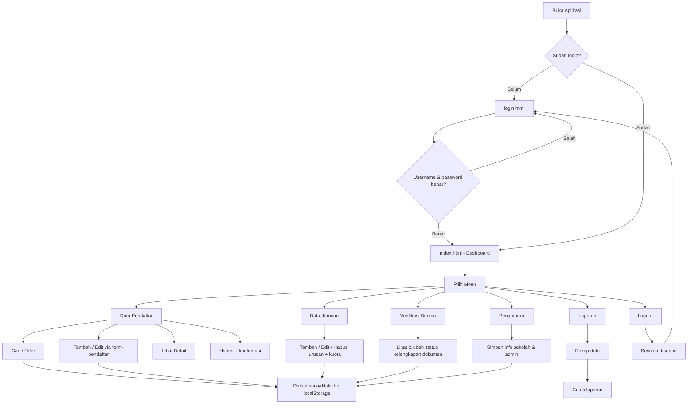
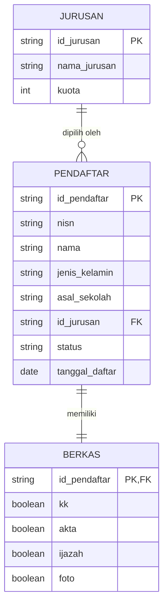

# PERANCANGAN.md
# Admin Panel (Back-Office) Sistem PPDB Online — SMAN 1 CILOGRANG

## 1. Identitas Proyek

**Nama:** Admin Panel PPDB Online SMAN 1 CILOGRANG
**Jenis Tugas:** Client-Side Programming
**Tema UI:** Neumorphism (Neumorfisme)
**Teknologi:** HTML5 · CSS3 · JavaScript Vanilla · Chart.js · localStorage
**Backend / Database Server:** Tidak digunakan. Seluruh data disimpan pada `localStorage` browser dengan data awal (mock data).
**Penyimpanan:** `localStorage` + mock data
**Status:** Final — seluruh halaman saling terhubung dan responsif

---

## 2. Tujuan Sistem

Sistem dibuat untuk membantu admin sekolah memantau dan mengelola proses Penerimaan Peserta Didik Baru (PPDB) secara digital melalui panel back-office di browser. Tujuannya:

1. Menampilkan ringkasan proses PPDB dalam satu Dashboard (total pendaftar, terverifikasi, menunggu verifikasi, diterima, dan grafik pendaftar per jurusan).
2. Mengelola data calon peserta didik: melihat, mencari, menambah, mengedit, menghapus, dan melihat detail data.
3. Mengelola data jurusan beserta kuota penerimaan.
4. Memantau status kelengkapan berkas setiap pendaftar.
5. Menyediakan rekapitulasi data dan cetak laporan untuk kebutuhan administrasi sekolah.
6. Mengatur informasi sekolah dan admin yang dipakai di seluruh halaman.
7. Dijalankan tanpa backend, tanpa database server, dan tanpa framework (tanpa React/Vue/PHP/Laravel/MySQL) agar sederhana dan sesuai lingkup tugas.

---

## 3. Target Pengguna

| Aspek | Keterangan |
|---|---|
| Pengguna utama | Admin / operator sekolah SMAN 1 CILOGRANG |
| Literasi teknologi | Cukup menggunakan browser dan aplikasi perkantoran dasar |
| Perangkat | Laptop/desktop di ruang tata usaha, tablet, atau ponsel |
| Kebutuhan | Cepat, mudah dipahami, minim langkah, tidak perlu pelatihan panjang |
| Akses | Satu akun admin bersifat demo (lokal, tanpa server) |

---

## 4. Struktur Menu

```text
Login (login.html)
└── Admin Panel
    ├── Dashboard (index.html)
    │   ├── Statistik: Total Pendaftar
    │   ├── Statistik: Terverifikasi
    │   ├── Statistik: Menunggu Verifikasi
    │   ├── Statistik: Diterima
    │   └── Grafik Pendaftar Berdasarkan Jurusan
    ├── Data Pendaftar (pendaftar.html)
    │   ├── Pencarian (nama, NISN, asal sekolah)
    │   ├── Filter jurusan & status
    │   ├── Tambah Pendaftar (form-pendaftar.html)
    │   ├── Edit Pendaftar (form-pendaftar.html?edit=ID)
    │   ├── Detail Pendaftar (modal)
    │   └── Hapus Pendaftar (konfirmasi)
    ├── Data Jurusan (jurusan.html)
    │   ├── Tambah Jurusan
    │   ├── Edit Jurusan (nama & kuota)
    │   └── Hapus Jurusan
    ├── Verifikasi Berkas (verifikasi.html)
    │   ├── Pencarian & filter kelengkapan
    │   └── Status dokumen: KK, Akta, Ijazah, Pas Foto
    ├── Laporan (laporan.html)
    │   ├── Statistik rekap
    │   ├── Rekap pendaftar per jurusan
    │   ├── Detail seluruh pendaftar
    │   └── Cetak laporan
    ├── Pengaturan (pengaturan.html)
    │   ├── Informasi sekolah (nama, tahun ajaran, alamat)
    │   └── Informasi admin (nama, email)
    └── Logout → login.html
```

---

## 5. User Flow



---

## 6. ER-D (Entity Relationship Diagram)



**Keterangan pemetaan konsep ke penyimpanan:**

| Entitas | Lokasi di localStorage | Kunci |
|---|---|---|
| PENDAFTAR | array objek | `ppdb_pendaftar` |
| JURUSAN | array objek | `ppdb_jurusan` |
| BERKAS | objek `berkas` di dalam tiap pendaftar | `ppdb_pendaftar[].berkas` |
| Pengaturan (bonus) | objek | `ppdb_settings` |

**Relasi:**
- Satu jurusan memiliki banyak pendaftar (`JURUSAN 1 -- N PENDAFTAR`).
- Satu pendaftar memiliki satu data berkas (`PENDAFTAR 1 -- 1 BERKAS`), berisi 4 dokumen wajib: Kartu Keluarga, Akta Kelahiran, Ijazah, dan Pas Foto.

---

## 7. Design System — Neumorphism

### 7.1 Konsep Neumorphism

Neumorphism (soft UI) adalah gaya visual yang membuat elemen seolah "terangkat" atau "terbenam" dari latar yang warnanya sama. Prinsip yang diterapkan:

- **Latar seragam:** seluruh halaman memakai abu-abu muda `#e4e9f1`, sehingga batas antar-elemen dibentuk oleh bayangan, bukan garis.
- **Soft shadow (raised):** kartu, tombol, dan stat card memakai dua bayangan sekaligus — gelap di kanan-bawah dan terang di kiri-atas — sehingga terlihat naik dari permukaan.
- **Inset (terbenam):** input, search box, progress bar, dan panel detail memakai bayangan dalam sehingga terlihat "ditekan" ke bawah.
- **Rounded corner:** radius 12–30px agar bentuk lembut dan konsisten.
- **Feedback interaktif:** tombol turun ke efek *inset* saat ditekan, kartu sedikit terangkat saat hover.
- **Aksesibilitas:** warna teks utama `#2f3b52` pada latar `#e4e9f1` tetap memiliki kontras yang aman, dan status selalu memakai badge berwarna + teks (bukan hanya warna).

### 7.2 Warna

| Token | HEX | Penggunaan |
|---|---|---|
| Background | `#e4e9f1` | Latar seluruh halaman (abu-abu muda) |
| Shadow Dark | `#b0bacb` | Bayangan gelap raised/inset |
| Shadow Light | `#ffffff` | Bayangan terang raised/inset |
| Primary | `#2f6fed` | Tombol utama, ikon aktif, grafik, fokus input |
| Primary Dark | `#2459c9` | Menu sidebar aktif, hover |
| Primary Soft | `#dde8ff` | Latar menu aktif |
| Text | `#2f3b52` | Teks utama |
| Muted | `#78879f` | Teks sekunder, label, placeholder |
| Success | `#26915a` / `#d6f0e2` | Status diterima / berkas lengkap |
| Warning | `#b97a12` / `#fbeccd` | Status menunggu / berkas belum lengkap |
| Danger | `#c53c3c` / `#fbdada` | Status ditolak, tombol hapus, error |
| Info | `#2158bd` / `#d9e6fd` | Status terverifikasi |
| Purple / Orange | `#6d4aff` / `#c97a10` | Aksen ikon statistik |

### 7.3 Typography

- **Font utama:** Poppins (Google Fonts) — pilihan alternatif: Inter.
- **Bobot:** 400 (body), 500 (label/menu), 600 (judul kecil & tombol), 700 (angka statistik).
- **Ukuran:** body 14px · tabel 13.5px · label 12.5px · judul halaman 23px · nilai statistik 26px.
- **Ikonografi:** Google Material Icons (font ikon), ukuran 18–26px.
- **Line height:** 1.6 agar nyaman dibaca.

### 7.4 Komponen UI

| Komponen | Bentuk Neumorphism | Dipakai pada |
|---|---|---|
| Card | Raised (shadow luar), radius 22px | Semua konten utama |
| Button Primary | Gradient biru + shadow luar, inset saat ditekan | Aksi utama (simpan, tambah, cetak) |
| Button Default | Raised netral, teks biru saat hover | Aksi sekunder (batal, kembali) |
| Icon Button | Kotak kecil radius 14px, raised | Aksi baris (detail, edit, hapus) |
| Text Field / Select | Inset (shadow dalam), ring biru saat fokus | Seluruh form & filter |
| Search Box | Inset dengan ikon pencarian | Data Pendaftar, Verifikasi Berkas |
| Statistic Card | Raised + ikon kotak raised | Dashboard, Laporan |
| Data Table | Border halus antar baris, hover transparan | Semua tabel |
| Status Badge | Pill raised bertinta warna + titik indikator | Status pendaftar & berkas |
| Berkas Pill | Pill toggle raised (hijau/merah) | Verifikasi Berkas |
| Progress Bar | Inset track + isi gradient biru | Kuota jurusan |
| Modal | Backdrop blur + kartu radius 26px (animasi pop) | Detail, form jurusan, konfirmasi |
| Toast | Kartu raised di kanan-bawah, ikon status | Notifikasi semua aksi |
| Sidebar | Panel tetap dengan shadow kanan, menu aktif raised bertinta biru | Semua halaman |
| Avatar Chip | Lingkaran raised + nama admin | Top bar |

---

## 8. Responsive Design

Prinsip: **mobile-first collision** — satu kode HTML/CSS melayani desktop, tablet, dan ponsel tanpa halaman terpisah.

| Breakpoint | Target | Perilaku |
|---|---|---|
| `> 992px` | Desktop / laptop | Sidebar menempel di kiri (264px), konten `margin-left` 264px, statistik 4 kolom, form 2 kolom |
| `≤ 1180px` | Layar sedang | Kartu statistik turun menjadi 2 kolom |
| `≤ 992px` | Tablet | Sidebar berubah menjadi **off-canvas** (tersembunyi), muncul tombol hamburger `☰`, sidebar muncul sebagai lapisan atas dengan overlay gelap; grid 2 kolom menjadi 1 kolom |
| `≤ 700px` | Ponsel | Statistik 1 kolom, form & detail 1 kolom, breadcrumb diringkas, nama admin disembunyikan, tombol form menempel penuh, search & filter mengalir ke baris baru, toast selebar layar |

Teknik yang digunakan:

1. **CSS Grid & Flexbox** — `grid-template-columns: repeat(auto-fill, minmax(...))` pada kartu jurusan agar jumlah kolom menyesuaikan lebar layar otomatis.
2. **Off-canvas sidebar** — `transform: translateX()` + transisi 0.25s, dikendalikan tombol hamburger dan klik overlay.
3. **Tabel responsif** — pembungkus `.table-wrap` dengan `overflow-x: auto` sehingga tabel lebar dapat digeser horizontal di ponsel tanpa merusak layout.
4. **`viewport` meta tag** — `<meta name="viewport" content="width=device-width, initial-scale=1.0">`.
5. **Ukuran sentuh (touch target)** — tombol ikon minimal 34–42px agar nyaman disentuh.
6. **Cetak (print media query)** — sidebar, topbar, tombol, dan footer disembunyikan; kartu kehilangan bayangan dan memakai border tipis agar laporan rapi saat dicetak.

---

## 9. Struktur Folder & Halaman

```text
PPDB-ONLINE-ADMIN-SMAN-1-CILOGRANG/
├── login.html              → Halaman login (akun demo)
├── index.html              → Dashboard (statistik + grafik Chart.js)
├── pendaftar.html          → Data Pendaftar (search, filter, CRUD, detail)
├── form-pendaftar.html     → Form tambah / edit pendaftar (validasi)
├── jurusan.html            → Data Jurusan (nama + kuota)
├── verifikasi.html         → Verifikasi Berkas (status kelengkapan)
├── laporan.html            → Laporan (rekap + cetak)
├── pengaturan.html         → Pengaturan (info sekolah & admin)
├── css/
│   └── style.css           → Seluruh style Neumorphism + responsive + print
├── js/
│   ├── data.js             → Data layer localStorage + mock data (10 pendaftar)
│   ├── app.js              → Sidebar, session, toast, modal, konfirmasi, util
│   ├── login.js            → Logika login
│   ├── dashboard.js        → Statistik + grafik Chart.js
│   ├── pendaftar.js        → Search, filter, detail, hapus
│   ├── form-pendaftar.js   → Validasi form, tambah & edit
│   ├── jurusan.js          → CRUD jurusan + kuota
│   ├── verifikasi.js       → Status kelengkapan berkas
│   ├── laporan.js          → Rekap + window.print()
│   └── pengaturan.js       → Simpan info sekolah & admin
├── assets/
│   └── img/
│       └── images.jpg      → Logo sekolah (foto)
├── PERANCANGAN.md
└── README.md
```

**Sumber pihak ketiga (hanya font, ikon, dan library CDN):**
- Google Fonts — Poppins
- Google Material Icons
- Chart.js 4 (CDN `cdn.jsdelivr.net`)

---

## 10. Penyimpanan Data (localStorage)

| Kunci | Isi | Data awal |
|---|---|---|
| `ppdb_session` | Status login (`1` = masuk) | — |
| `ppdb_pendaftar` | Array data pendaftar + objek berkas | 10 mock data pendaftar |
| `ppdb_jurusan` | Array jurusan (`id`, `nama`, `kuota`) | IPA, IPS, Bahasa |
| `ppdb_settings` | Info sekolah & admin | SMAN 1 CILOGRANG, 2026/2027 |

Mock data pendaftar digunakan otomatis saat kunci belum ada di browser, sehingga aplikasi langsung berisi data saat pertama dibuka.

---

## 11. Cara Menjalankan

1. Buka folder proyek di **VS Code**.
2. Install extension **Live Server**.
3. Klik kanan `index.html` → **Open with Live Server** (atau buka `login.html`).
4. Login dengan akun demo: **admin / admin123**.

> Dapat juga dibuka langsung dengan klik dua kali `index.html` pada browser.

---

## 12. Catatan Penutup

- Data hanya tersimpan di browser masing-masing (localStorage), bukan di server — cocok untuk demo/prototype tugas Client-Side Programming.
- Login bersifat demo lokal, belum ada autentikasi & otorisasi server-side.
- Untuk sistem PPDB produksi, diperlukan backend, database, autentikasi, validasi di sisi server, audit log, serta perlindungan data pribadi sesuai ketentuan yang berlaku.
